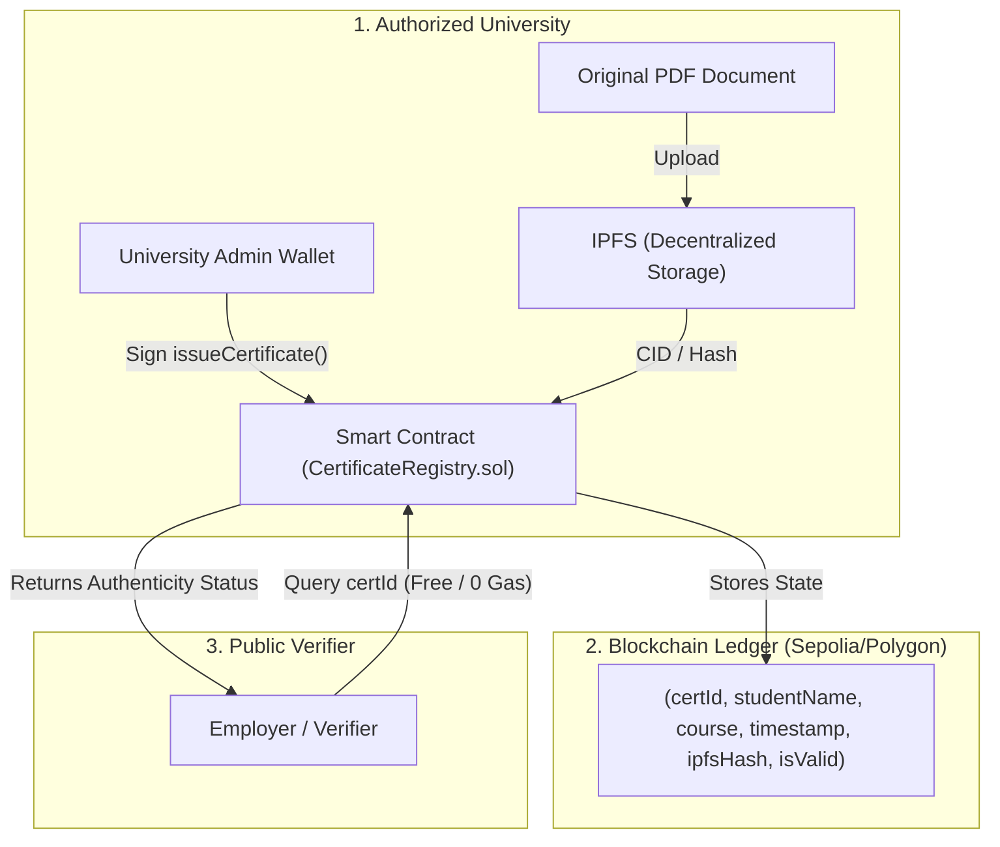

# 🎓 CertChain - Blockchain Certificate Verification System

An end-to-end, decentralized, tamper-proof academic credential issuance and verification platform built on Ethereum-compatible blockchains, Solidity, and Ethers.js.

---

## 🌟 Features

- **Decentralized & Tamper-Proof**: Certificates are stored on an immutable blockchain ledger, preventing counterfeit degrees and unauthorized alterations.
- **Zero-Gas Public Verification**: Anyone (employers, academic boards, background checkers) can verify certificates instantly without gas fees, wallet extensions, or sign-ups.
- **Institution / Issuer Portal**: Authenticated admin interface for authorized university accounts to issue and sign certificates on-chain.
- **Certificate Revocation**: Support for marking invalid or cancelled certificates as revoked with audit trail and revocation reason.
- **IPFS Storage Support**: Links directly to permanent decentralized storage for certificate PDFs/documents via IPFS CIDs.
- **Immediate Out-of-the-Box Demo Mode**: Pre-configured with simulation fallbacks so the entire UI can be tested offline or before deploying the smart contract.
- **Print & Export Ready**: Built-in clean print formatting to export verified certificate reports to PDF.

---

## 📁 Project Structure

```
BLOCK CHAIN/
│
├── contracts/
│   ├── CertificateRegistry.sol         # Solidity Smart Contract (Issuance, Verification, Revocation)
│   └── CertificateRegistryABI.json     # Full JSON ABI definition
│
├── js/
│   ├── config.js                       # Network settings, contract address, and ABI constants
│   ├── verify.js                       # Public verification client (Ethers.js provider integration)
│   └── issuer.js                       # Admin issuing & revocation client (MetaMask signer integration)
│
├── css/
│   └── style.css                       # Modern, responsive Web3 UI & print stylesheets
│
├── deploy/
│   └── remix_guide.md                  # Quick 2-minute deployment guide via Remix IDE
│
├── INDEX.HTML                          # Public Certificate Verification Portal
├── issuer.html                         # University Issuer / Admin Management Portal
└── README.md                           # Comprehensive documentation
```

---

## 🚀 Quick Start (Testing Locally)

You can run and test this project immediately in any web browser:

1. **Open the Verification Portal**:
   - Double-click `INDEX.HTML` in your browser.
   - Click the sample chips (`BCA2026-001` or `BCA2026-002`) to test valid and revoked verification states.
2. **Open the Issuer Portal**:
   - Navigate to `issuer.html` (or click "Issuer Portal" in the top navbar).
   - Enter student details, click **"Issue & Sign Certificate"**, and test registering new credentials.

---

## ⛓️ Deploying to the Live Blockchain (Sepolia Testnet)

### 1. Deploy the Smart Contract
Follow the step-by-step guide in [deploy/remix_guide.md](deploy/remix_guide.md):
1. Open [Remix Ethereum IDE](https://remix.ethereum.org).
2. Copy and paste `contracts/CertificateRegistry.sol`.
3. Compile with Solidity `0.8.20`.
4. Deploy using MetaMask on **Sepolia Testnet**.

### 2. Connect Your Deployed Contract
Open `js/config.js` and paste your deployed contract address:
```javascript
const CONFIG = {
    CONTRACT_ADDRESS: "0xYourDeployedAddressHere",
    ...
};
```
Refresh `INDEX.HTML` and `issuer.html`. The network status pill will change from *Demo Mode* to **Live Contract Connected**.

---

## 🌐 Deploying Frontend to the Web (Free Hosting)

This frontend contains static HTML, CSS, and JS (with Ethers.js loaded via CDN), making it compatible with any static host:

### Option A: Vercel / Netlify
1. Drag and drop the `BLOCK CHAIN` folder into [Netlify Drop](https://app.netlify.com/drop) or push to GitHub and import into [Vercel](https://vercel.com).
2. No build step or environment variables required.

### Option B: GitHub Pages
1. Initialize a git repository and push to GitHub:
   ```bash
   git init
   git add .
   git commit -m "Initial commit of Blockchain Certificate System"
   git remote add origin https://github.com/your-username/certchain.git
   git branch -M main
   git push -u origin main
   ```
2. In your GitHub repository settings, go to **Pages** -> Source: **Deploy from a branch (`main` / root)**.
3. Your site is live worldwide with HTTPS in seconds!

---

## 🔒 Security Architecture



---

## 📄 License
This project is open-source under the [MIT License](https://opensource.org/licenses/MIT).
